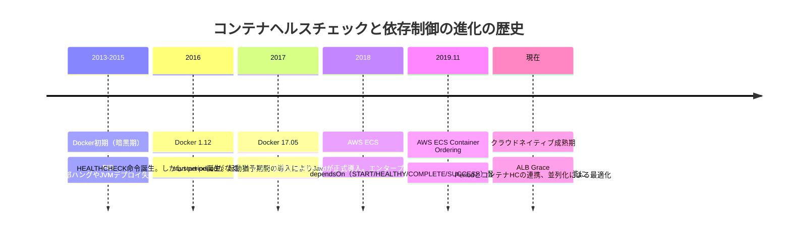
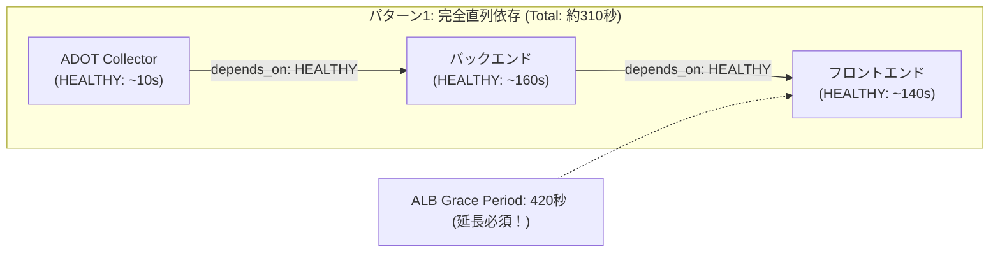
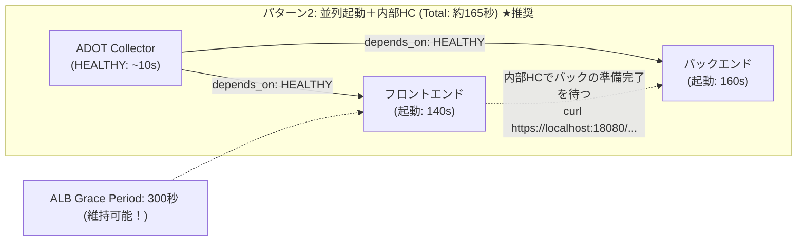
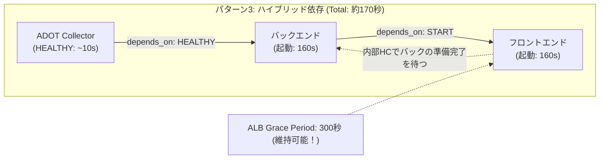

# AWS ECS Fargate ヘルスチェック & ALB Grace Period 完全設計ガイド
**〜 コンテナ起動順序制御（depends_on）、内部ヘルスチェックによる直列化回避、デプロイバッファ積算根拠、および300秒タイムアウト障害の解決 〜**

---

## 1. エグゼクティブサマリ（要約と推奨結論）

### 1.1 現状の課題と300秒タイムアウト障害の根本原因
ECS Fargateタスク内において、フロントエンドコンテナとバックエンドコンテナに `depends_on (Condition: HEALTHY)` による直列起動関係を設定した場合、以下の順序で起動処理がブロック（直列化）されます。

```
[タスク作成・RUNNING遷移 (T=0s)] ── ALB Grace Period (300秒) タイマースタート！
  │
  ├─ ① ADOT Collector 起動 & HEALTHY化 ───────── 約 10秒
  │
  ├─ ② バックエンドコンテナ 起動 & HEALTHY化 ─── 最大 160秒（実測20〜80s ＋ バッファ80s）
  │    （※ADOTが健全化するまで起動待機）
  │
  └─ ③ フロントエンドコンテナ 起動 & HEALTHY化 ── 最大 140秒（実測15〜70s ＋ バッファ70s）
       （※バックエンドが健全化するまで起動待機）
```

- **タスク全体の起動完了時間**：$10\text{秒} + 160\text{秒} + 140\text{秒} = \mathbf{310\text{秒}}$（通常時でも約240〜270秒）
- **ALB Grace Period**：$\mathbf{300\text{秒}}$

**【障害の発生メカニズム】**  
タスクが起動してから300秒が経過した時点で、ALBのGrace Period（ヘルスチェック保護猶予）が満了します。直列構成では、バックエンドがHEALTHYになった（約160〜170秒経過）後からフロントエンドがJBoss EAPの起動を開始するため、300秒時点ではフロントエンドがまだ起動処理の途中（またはALBのヘルスチェック連続成功判定中）となります。  
ALBはフロントエンドから応答（HTTP 200）を得られないため「Unhealthy」と報告し、ECSサービススケジューラはタスクを強制終了（SIGTERM）して再起動を繰り返す**「デプロイ不能の無限クラッシュループ（CrashLoop）」**に陥ります。

---

### 1.2 推奨アーキテクチャ：パターン2（並列起動 ＋ 内部ヘルスチェック活用）
本ガイドで最も強く推奨する解決策は、**フロントコンテナとバックコンテナ間の `depends_on` を解除し、並列起動させる「パターン2」**です。

1. **直列化の完全回避**：
   フロントエンドコンテナ内に設定されたコンテナヘルスチェック（`curl -k https://localhost:18080/iwinmichl/healthcheck`）がバックエンドのSpringコントローラ疎通を確認しているため、タスク起動時に両コンテナを同時に立ち上げても、バックエンドが完全準備完了するまでフロントエンドは `HEALTHY` になりません。
2. **起動時間の劇的短縮**：
   タスク起動時間は直列和（$160\text{s} + 140\text{s} = 300\text{s}$超）から、**並列の最大値 $\max(160\text{s}, 140\text{s}) + 10\text{s} \fallingdotseq \mathbf{165\text{秒}}$**（通常時は約90〜105秒）へとほぼ半減します。
3. **現行ALB Grace Period（300秒）の維持**：
   最大でも165秒で健全化するため、現行の300秒設定で**「約135秒」の巨大な安全マージン**が確保され、タイムアウト障害を完全に根絶できます。

---

## 2. 小学生にもわかる！たとえ話で理解するコンテナ起動とALBの仕組み

### 「文化祭の模擬店（クレープ屋さん）のオープン準備」

みんなのクラスで、文化祭で大人気の「クレープ屋さん」を出店することになりました！

```
┌────────────────────────────────────────────────────────┐
│               【文化祭のクレープ屋さん】                │
│                                                        │
│  [校長先生 (ALB)] ── 5分後(300秒)に見回りに来るぞ！     │
│                                                        │
│  [レジ・ノート係 (ADOT Collector)] ── 10秒で準備完了   │
│  [温度計係 (CloudWatch Agent)]     ── 10秒で準備完了   │
│                                                        │
│  [調理係 (バックエンド)] ── 生クリームと生地作り(160秒) │
│  [接客係 (フロントエンド)] ── 看板・メニュー並べ (140秒)│
└────────────────────────────────────────────────────────┘
```

#### 登場人物と係の仕事
- **校長先生（ALBのグレースピリオド）**：  
  「準備開始から5分後（300秒後）に見回りに来るぞ！そのときにお客さんを迎えられる状態になっていなかったら、この店は失格（強制解散・やり直し）だ！」とルールを決めました。
- **レジ・ノート係（ADOT Collector）**：  
  電卓と売上ノートを開く係。10秒ですぐ準備完了します。
- **温度計係（CloudWatch Agent）**：  
  冷蔵庫の温度を測る係。これもすぐ完了します。
- **調理係（バックエンドコンテナ / JBoss EAP）**：  
  重たいミキサーを使って生地を焼き、生クリームを泡立てる係。時間がかかります（普段は20〜80秒、念のための予備時間を入れて最大160秒）。
- **接客係（フロントエンドコンテナ / JBoss EAP）**：  
  お店の看板を出してメニュー表を並べ、お客さんから注文を受ける係。これも準備に時間がかかります（最大140秒）。

---

#### 失敗したお店のお話（パターン1：完全直列）
接客係の子が、**「調理係の子が生クリームを完成させるまで、私は腕組みして何もしないで待つ！」**と決めました（これが `depends_on: HEALTHY` です）。

1. レジ係が10秒で準備完了。
2. 調理係が一生懸命生クリームを作り始め、最大160秒かかってようやく完成させました。
3. 調理係が完成した合図（HEALTHY）を出したのを見て、接客係がようやく「よし、じゃあ私も看板を並べ始めるか」とのんびり準備を開始しました（さらに140秒かかる！）。
4. 合計時間：$10\text{秒} + 160\text{秒} + 140\text{秒} = \mathbf{310\text{秒}}$！
5. **ドカーン！** 5分（300秒）経った瞬間に校長先生（ALB）が見回りに来ました。  
   「おい！接客係がまだ看板を並べている途中じゃないか！お客さんを迎えられないなら失格だ！全員最初からやり直し！」と怒られ、お店は強制解散させられてしまいました。

---

#### 大成功したお店のお話（パターン2：並列準備 ＋ 賢い声かけ）
そこでみんなで作戦会議を開きました。  
「接客係の子が腕組みして待っている時間がもったいないよ！最初から一緒に看板を並べ始めようよ！」（並列起動）

1. レジ係が10秒で準備完了。
2. **調理係と接客係が、最初から同時に準備をスタート！**
3. 接客係は看板を並べながら、ときどき調理係に「生クリームできた〜？」と声をかけて確認します（これが内部ヘルスチェック：`https://localhost:18080/iwinmichl/healthcheck`）。
4. 調理係が生クリームを完成させたとき（最大160秒後）、接客係の看板並べ（140秒）もすでに終わっていました！
5. 合計時間：一番時間がかかる調理係の**「165秒」**で全員の準備が完了！
6. 校長先生（ALB）が5分（300秒）で見回りに来たときには、1分以上も前から完璧な笑顔でお客さんを迎える準備ができていました。校長先生も「素晴らしい！」と大絶賛しました。

---

## 3. 歴史と背景：なぜこれらの機能が必要になったのか？

コンテナオーケストレーションにおけるヘルスチェックと起動順序制御は、エンタープライズJavaアプリケーションのコンテナ化の歴史そのものです。



### 3.1 Docker初期の暗黒期（2013〜2015年）：ブラックボックスとしてのコンテナ
初期のDockerエンジンには「ヘルスチェック」という概念がありませんでした。Dockerは「コンテナ内部のPID 1（親プロセス）が生きているかどうか」だけを監視していました。  
しかし、JBoss EAPやWebLogicのようなエンタープライズJavaサーバーでは、**「プロセスは生きているが、内部でOutOfMemoryErrorが発生してスレッドが全滅している」「クラスロードに失敗してWARのデプロイが中断している」「データベース接続が取れず起動がハングしている」**という状態が日常的に発生します。  
Dockerはこれを「元気に稼働中（Running）」と誤認し、壊れたコンテナにリクエストを送り続ける大惨事が頻発しました。

### 3.2 HEALTHCHECK命令の導入（2016年 Docker 1.12）と「早死にの悲劇」
コンテナ自身が内側から健全性を確認できるように、Docker 1.12で `HEALTHCHECK` 命令が追加されました。  
しかし、初期仕様には「起動猶予期間（startPeriod）」がありませんでした。  
起動に60秒かかるJBossを動かすと、起動開始から10秒ごとにヘルスチェックが走り、3回連続失敗（計30秒）した瞬間にDockerから「UNHEALTHY」の烙印を押され、アプリが立ち上がる前に強制終了されるという「早死にの悲劇」が多発しました。

### 3.3 startPeriod の誕生（2017年 Docker 17.05 / 2018年 ECS対応）
この問題を解決するために開発されたのが `startPeriod`（起動猶予期間）です。  
**「指定した秒数の間は、ヘルスチェックが何度失敗しても失敗回数（retries）にカウントしない」**という画期的なセーフティネットが作られました。

### 3.4 ECS Container Dependency Ordering の発表（2019年11月）
かつてのECSタスク内では、すべてのコンテナが同時に起動（並列起動）するしかありませんでした。  
しかし、マイクロサービス化に伴い、以下のようなサイドカーコンテナが不可欠になりました。
- **ADOT Collector（OpenTelemetry）**：APMトレース収集
- **Envoy（App Mesh）**：サービスメッシュプロキシ
- **DBマイグレーションコンテナ**：起動時にFlywayやLiquibaseを実行

「アプリが起動した瞬間に送信したトレースが、ADOTがまだ立ち上がっていないせいで失われる」「DBマイグレーションが終わる前にアプリがテーブルを見に行ってクラッシュする」という問題を解決するため、AWSは2019年11月にタスク定義の `dependsOn` 機能をリリースしました。

---

## 4. アーキテクチャ動作原理の深堀り

### 4.1 ECS Fargateにおける `awsvpc` ネットワークと `localhost` 通信
ECS Fargateでは、すべてのタスクに専用のElastic Network Interface（ENI）が1つ割り当てられます。  
タスク内で動作するすべてのコンテナ（フロント、バック、ADOT、CloudWatch Agent）は、**同一のネットワーク名前空間（Network Namespace）と同一のプライベートIPアドレスを共有**します。

```mermaid
graph TB
    subgraph Fargate_Task ["ECS Fargate タスク (同一ENI / 同一ネットワーク名前空間)"]
        subgraph Net ["localhost (127.0.0.1)"]
            FRONT["フロントエンドコンテナ\n(JBoss EAP : ポート8443)"]
            BACK["バックエンドコンテナ\n(JBoss EAP : ポート18080)"]
            ADOT["ADOT Collector\n(OTel : ポート13133 / 4317)"]
            CW["CloudWatch Agent\n(Procstat / EMF)"]
        end
    end
    
    ALB["ALB (Application Load Balancer)"] -->|外側からヘルスチェック (ポート8443)| FRONT
    FRONT -->|内側から内部ヘルスチェック (https://localhost:18080/iwinmichl/healthcheck)| BACK
    BACK -->|起動直後からトレース送信 (localhost:4317)| ADOT
```

- フロントエンドコンテナからバックエンドコンテナへは、VPCのルーティングテーブルやセキュリティグループを経由せず、OS内部のループバックインターフェース（`localhost` / `127.0.0.1`）経由でマイクロ秒レベルの極小レイテンシで通信できます。
- したがって、フロントエンドから `https://localhost:18080/iwinmichl/healthcheck` を叩くヘルスチェックは、極めて高信頼かつ高速に動作します。

---

### 4.2 コンテナヘルスチェック vs ALBヘルスチェックの役割分担

多くのエンジニアが混同しやすいのが、「コンテナヘルスチェック」と「ALBターゲットグループヘルスチェック」の違いです。この2つは全く異なるレイヤーで動作しています。

| 項目 | コンテナヘルスチェック (ECSエージェント管轄) | ALBターゲットグループヘルスチェック (ALB管轄) |
| :--- | :--- | :--- |
| **実行場所** | Fargateタスクの内部（各コンテナ内） | VPC内のALBノード（タスクの外部） |
| **通信経路** | コンテナ内のシェルまたはローカルループバック | ALBノードからタスクENIのプライベートIP宛て |
| **監視対象** | 個々のコンテナプロセス、ポート、依存関係 | フロントエンドコンテナの公開ポート（8080/8443等） |
| **監視単位** | コンテナ単位（タスク内に4個存在） | ターゲット単位（ALBはバックやADOTの存在を知らない） |
| **失敗時の動作** | essentialコンテナならタスク全体を停止 | タスクへのトラフィック遮断、サービスによるタスク入替 |

---

### 4.3 `startPeriod` の真の動作仕様（よくある誤解の解消）

> [!IMPORTANT]
> **よくある誤解**：「startPeriod に 160秒を設定すると、コンテナ起動後 160秒間はヘルスチェックが実行されない（スリープする）？」  
> **真実**：**いいえ、違います。ヘルスチェックは起動直後から `interval` ごとに実際に実行され続けます！**

1. **猶予期間中の失敗（Failure）**：  
   `startPeriod` 期間中にヘルスチェックが失敗しても、連続失敗回数（`retries`）のカウントは**常にゼロにリセット**され、コンテナが `UNHEALTHY` になることはありません。
2. **猶予期間中の成功（Success）**：  
   `startPeriod` の最中であっても、**一度でもヘルスチェックが成功した瞬間、そのコンテナは直ちに `HEALTHY` に昇格し、`startPeriod` は即座に消滅（途中終了）します**。
3. **結論**：  
   `startPeriod` を長め（例：160秒）に設定しても、アプリが20秒で起動完了すれば20秒の時点で直ちにHEALTHYになります。「無駄な待ち時間が発生する」ということは一切ありません。

---

### 4.4 `healthCheckGracePeriodSeconds` のタイマー仕様

1. **タイマー開始の瞬間**：  
   タスクのプロビジョニングが完了し、タスクステータスが **`RUNNING` に遷移した瞬間（T=0）** にタイマーのカウントダウンが始まります。
2. **保護の仕組み**：  
   Grace Period のカウント中（例：0〜300秒の間）、ALBがタスクに対してプローブを送り、応答がなくて「Unhealthy」と判定していても、ECSサービススケジューラはその報告を**完全に無視（抑制）**します。
3. **死刑執行の瞬間**：  
   Grace Period が1秒でも切れた瞬間（T=301秒）、ALBのターゲットステータスがまだ「Healthy」に達していなければ、ECSサービススケジューラは「ターゲット登録失敗」とみなし、タスクに即座に終了命令（SIGTERM）を発行します。

---

## 5. デプロイバッファの内訳と秒数計算（詳細積算根拠）

JBoss EAPの起動時間は、なぜ単体実測値（バック20〜80秒、フロント15〜70秒）から大きく揺れるのでしょうか。  
ここでは、デプロイバッファに含まれる時間の内訳を論理的・数理的に分解して算出します。

### 5.1 実測値の揺れとバッファ算出式

```
[設定 startPeriod] ＝ [実測最大時間 (Max)] ＋ [デプロイバッファ (Buffer)]
                   ＝ [実測最大時間 (Max)] × 2.0 (安全係数 2.0)
```

- **バックエンドコンテナ**：
  - 実測最小時間：20 秒 ／ 実測最大時間：80 秒（揺れ幅：60 秒）
  - デプロイバッファ：**＋80 秒**
  - **設定 startPeriod ＝ $80\text{秒} + 80\text{秒} = \mathbf{160\text{秒}}$**
- **フロントエンドコンテナ**：
  - 実測最小時間：15 秒 ／ 実測最大時間：70 秒（揺れ幅：55 秒）
  - デプロイバッファ：**＋70 秒**
  - **設定 startPeriod ＝ $70\text{秒} + 70\text{秒} = \mathbf{140\text{秒}}$**

---

### 5.2 デプロイバッファに含まれる時間の詳細内訳（積算根拠）

| 内訳項目（遅延・揺れの要因） | バックエンド加算秒数 | フロントエンド加算秒数 | 発生メカニズムと詳細理由 (JBoss EAP / Fargate / Spring 特性) |
| :--- | :---: | :---: | :--- |
| **① Fargate vCPU スロットリング・共有リソース競合バッファ** | **＋25 秒** | **＋20 秒** | Fargateタスクに割り当てられた限られたvCPU上で、複数コンテナ（ADOT, CloudWatch Agent, JBoss×2台）が初期化を行う際、CPU使用率が100%に達します。LinuxのCFS（Completely Fair Scheduler）による時分割スロットリングが発生し、単体検証時よりもスレッド実行が延伸します。 |
| **② DBコネクションプール確立＆SSLハンドシェイク遅延バッファ** | **＋20 秒** | **＋5 秒** | JBoss起動時、IronJacamar / HikariCPがAmazon Aurora RDSに対して初期接続プール（Initial Pool Size）を一括確立します。コールドスタート時のDNS名前解決、SSL/TLS鍵交換、DB認証ハンドシェイクのネットワーク往復遅延を吸収します。 |
| **③ JVM JITコンパイル＆G1GC一時停止（STW）バッファ** | **＋15 秒** | **＋15 秒** | JBoss Modulesによる2,000以上のJARクラスロード時、JVMヒープへのオブジェクト急増に伴いG1GCのYoung GCが頻発します。またC2 JITコンパイラが起動時バイトコードをネイティブ最適化する際のCPU飽和によるStop-The-World（一時停止）を吸収します。 |
| **④ Spring Context 初期化＆リトライ待機バッファ** | **＋0 秒** | **＋15 秒** | フロントエンド起動時、Spring Bean定義のスキャン、HandlerMapping登録、内部RESTクライアント生成が行われます。バックエンドへの初回疎通が一時的に接続拒否(ECONNREFUSED)となった際のリトライバックオフ待機時間を吸収します。 |
| **⑤ ヘルスチェック周期（Interval）およびサンプリング遅れバッファ** | **＋20 秒** | **＋15 秒** | JBossのデプロイが完了した瞬間と、ECSエージェントがヘルスチェックコマンドを実行するタイミングには周期的なズレ（最大10秒）があります。コマンドタイムアウト(5秒)や判定周期のズレを確実に吸収するために必要です。 |
| **合 計 バ ッ フ ァ** | **＋80 秒** | **＋70 秒** | **最大実測値と同等の時間をバッファとして確保（安全率 2.0倍）** |

---

### 5.3 当初検討されていた「一律 210秒」の妥当性評価

- **210秒の背景**：  
  フロントエンドの最大実測値（70秒）のちょうど3倍（$70\text{s} \times 3 = 210\text{s}$）、バックエンド（80秒）の約2.6倍に相当する、極めて手厚い安全率を適用した一律値です。
- **直列構成（パターン1）での影響**：  
  直列構成で両方に210秒を適用すると、最悪ケースの猶予時間は $10\text{s} + 210\text{s} + 210\text{s} = \mathbf{430\text{秒}}$ となり、ALB Grace Period 300秒では確実に障害となります。
- **並列構成（パターン2）での影響**：  
  並列構成であれば、両方に210秒を設定しても並行してカウントダウンが進むため、タスク全体の起動時間は最大でも210秒で収まります。したがって、**並列構成（パターン2）を採用する場合であれば、運用上の設定統一を目的として両コンテナに210秒を設定しても何ら問題ありません**。

---

## 6. アーキテクチャパターン別の徹底比較と具体的な設定値一覧

### 6.1 パターン1：完全直列依存構成（安全重視・長時間）

ADOT $\rightarrow$ バックエンド $\rightarrow$ フロントエンド の順に `depends_on: Condition: HEALTHY` で完全に数珠つなぎにする構成です。



#### 設定値一覧（パターン1）
- **ALB Grace Period**: **`420 秒 (7分)`**（現在の300秒から延長必須）
- **ALB Target Group**: Interval 15s, Timeout 5s, HealthyThreshold 2回, UnhealthyThreshold 3回

| コンテナ名 | essential | depends_on 対象 | Condition | Command Type | HealthCheck コマンド | Interval | Timeout | Retries | startPeriod |
| :--- | :---: | :---: | :---: | :---: | :--- | :---: | :---: | :---: | :---: |
| **ADOT Collector** | `true` | なし | - | CMD | `curl -f http://localhost:13133/ \|\| exit 1` | 5s | 3s | 2 | **10s** |
| **CloudWatch Agent** | `true` | なし | - | CMD-SHELL | `/opt/aws/amazon-cloudwatch-agent/bin/amazon-cloudwatch-agent-ctl -m ec2 -a status \| grep running \|\| exit 1` | 10s | 5s | 2 | **15s** |
| **バックエンド** | `true` | adot-collector | `HEALTHY` | CMD-SHELL | `curl -k -f https://localhost:18080/iwinmichl/healthcheck \|\| exit 1` | 10s | 5s | 3 | **160s** |
| **フロントエンド** | `true` | backend-container | `HEALTHY` | CMD-SHELL | `curl -k -f https://localhost:18080/iwinmichl/healthcheck \|\| exit 1` | 10s | 5s | 3 | **140s** |

- **メリット**：フロント起動時にバックエンドAPIが100%確実に準備完了している。
- **デメリット**：タスク1台の起動に5〜7分かかり、デプロイやオートスケーリングが極めて遅い。ALB Grace Periodの延長が必須。

---

### 6.2 パターン2：並列起動 ＋ 内部ヘルスチェック構成 ★【強く推奨】

フロントコンテナとバックコンテナ間の `depends_on` を解除し、同時にJBoss EAPを起動させます。  
フロントエンドコンテナの内部ヘルスチェックがバックエンドの健全性を担保します。



#### 設定値一覧（パターン2）
- **ALB Grace Period**: **`300 秒 (維持可能)`**（最悪起動時間165秒に対し、約135秒の余裕）
- **ALB Target Group**: Interval 15s, Timeout 5s, HealthyThreshold 2回, UnhealthyThreshold 3回

| コンテナ名 | essential | depends_on 対象 | Condition | Command Type | HealthCheck コマンド | Interval | Timeout | Retries | startPeriod |
| :--- | :---: | :---: | :---: | :---: | :--- | :---: | :---: | :---: | :---: |
| **ADOT Collector** | `true` | なし | - | CMD | `curl -f http://localhost:13133/ \|\| exit 1` | 5s | 3s | 2 | **10s** |
| **CloudWatch Agent** | `true` | なし | - | CMD-SHELL | `/opt/aws/amazon-cloudwatch-agent/bin/amazon-cloudwatch-agent-ctl -m ec2 -a status \| grep running \|\| exit 1` | 10s | 5s | 2 | **15s** |
| **バックエンド** | `true` | adot-collector | `HEALTHY` | CMD-SHELL | `curl -k -f https://localhost:18080/iwinmichl/healthcheck \|\| exit 1` | 10s | 5s | 3 | **160s** |
| **フロントエンド** | `true` | adot-collector | `HEALTHY` | CMD-SHELL | `curl -k -f https://localhost:18080/iwinmichl/healthcheck \|\| exit 1` | 10s | 5s | 3 | **160s** |

> [!NOTE]
> **フロントエンドの startPeriod を 160秒にする理由**：  
> 並列起動時、フロントエンド自身のデプロイは最短15秒で終わる可能性がありますが、バックエンドの起動が最悪80秒＋バッファ＝160秒かかる場合、フロントのヘルスチェック（バックへのcurl）は最長160秒間失敗し続けます。そのため、フロントエンドの `startPeriod` もバックエンドの起動猶予に合わせて **`160秒`**（または一律値の **`210秒`**）に設定します。

#### 並列実行における重要なエンジニアリング注意事項（Frontier Coding 視点）
1. **Spring Context 初期化時のEagerなREST呼び出しの禁止**：  
   フロントエンドのSpringアプリケーション起動時（Bean初期化、`@PostConstruct`、`InitializingBean`）に、バックエンドAPIを同期呼び出しするコードが存在すると、バックエンドが未起動の場合に `ConnectException` が発生し、JBossへのWARデプロイそのものがクラッシュ（`DeploymentException`）します。  
   $\rightarrow$ **対策**：バックエンド呼び出しBeanは `@Lazy` を付与するか、リクエスト受信時に初めて接続する設計にしてください。
2. **FargateタスクのCPUサイジング**：  
   2台のJBoss EAPが同時にJITコンパイルとクラスロードを行うため、一時的にCPU使用率が100%に達します。  
   $\rightarrow$ **対策**：Fargateタスクサイズには少なくとも **2 vCPU（推奨: 4 vCPU）、4GB〜8GB メモリ** を割り当ててください。
3. **フロント自身の死活監視との複合化**：  
   フロントのヘルスチェックが「バックエンドへのcurl」だけだと、仮にフロントエンド自身のJBossがハングしていてもバックエンドが生きていればHEALTHYになってしまいます。  
   $\rightarrow$ **対策**：ヘルスチェックスクリプト内で「自身のポート（例: 8443）へのcurl」と「バックエンドへのcurl」の両方をチェックするシェルスクリプトを実行することを推奨します。

---

### 6.3 パターン3：ハイブリッド依存構成（depends_on: START）

バックエンドのコンテナプロセス（DockerデーモンによるPID 1生成）が開始されたことだけを確認し、JBossのHEALTHYを待たずにフロントエンドを立ち上げる構成です。



- **フロントエンドの depends_on**: `backend-container` (Condition: **`START`**)
- **ALB Grace Period**: **`300 秒`**
- **動作特徴**：バックエンドのDockerコンテナ起動（約1〜2秒）を確認してからフロントエンドが起動するため、コンテナ生成レースコンディションを防ぎつつ、並列起動と同等の速度（約165〜170秒）を実現できます。

---

## 7. 時系列動作タイムライン・シミュレーション（秒単位の推移）

### 7.1 シナリオ比較表（最悪ケースにおける時系列推移）

```mermaid
gantt
    title コンテナ起動タイムライン比較 (最悪ケース)
    dateFormat X
    axisFormat %s秒

    section パターン1 (直列・300sで失敗)
    ADOT起動 & HEALTHY化           :done,    p1_adot, 0, 10
    バックエンド JBoss起動 & HC    :active,  p1_back, 10, 170
    フロントエンド JBoss起動 (遅延) :crit,    p1_front, 170, 310
    ALB Grace Period 期限切れ      :milestone, p1_m, 300, 300

    section パターン2 (並列・300sで完全成功)
    ADOT起動 & HEALTHY化           :done,    p2_adot, 0, 10
    バックエンド JBoss起動 & HC    :done,    p2_back, 10, 170
    フロントエンド JBoss起動 & HC  :done,    p2_front, 10, 150
    全コンテナHEALTHY & ALB疎通    :milestone, p2_m, 165, 165
    ALB Grace Period 満了 (余裕135s):crit,    p2_end, 300, 300
```



| 経過時間 | パターン1（直列依存・Grace Period 300s） | パターン2（並列起動・Grace Period 300s）★推奨 |
| :---: | :--- | :--- |
| **0秒** | タスクRUNNING遷移。ALB Grace Periodタイマー開始(300s)。ADOT/CW Agent起動開始。 | タスクRUNNING遷移。ALB Grace Periodタイマー開始(300s)。ADOT/CW Agent起動開始。 |
| **5秒** | ADOTが13133ポートで応答。CW Agentプロセス稼働中。 | ADOTが13133ポートで応答。CW Agentプロセス稼働中。 |
| **10秒** | **ADOTがHEALTHY到達**。バックエンドコンテナが起動開始（JBoss起動）。フロントはブロック中。 | **ADOTがHEALTHY到達**。**バックエンドとフロントエンドが同時にJBoss起動開始！** |
| **30秒** | バックエンドがAurora RDSと接続プール確立中。フロントはまだ起動すらしていない。 | 両JBossがクラスロード・DBプール確立中（CPU使用率高負荷、並列進行）。 |
| **80秒** | バックエンド通常時デプロイ完了。フロントはまだブロック中。 | バックエンド＆フロントエンド通常時デプロイ完了。 |
| **105秒** | 【通常時】バックがHEALTHY到達 $\rightarrow$ フロントがようやく起動開始。 | **【通常時】フロント内部HC成功！タスク完全HEALTHY到達！ALB疎通完了！** |
| **160秒** | 【最悪時】バックがJBossデプロイ完了。 | 【最悪時】バックエンドがJBossデプロイ完了。 |
| **165秒** | 【最悪時】バックがHEALTHY到達 $\rightarrow$ **フロントがようやく起動開始！** | **【最悪時でもこの時点で両コンテナHEALTHY到達！ALB疎通完了！】** |
| **230秒** | フロントがJBossデプロイ中（最悪時は残り70秒必要）。 | 既に安定稼働中。トラフィックを安全に処理中。 |
| **300秒** | **【運命の境界・大障害発生】**<br>フロントはまだ起動中（160秒＋140秒＝300秒時点）。ALB Grace Periodが期限切れ！ALBがUnhealthyと判定し、**ECSがタスクを強制終了・再起動ループへ突入！** | **ALB Grace Period満了。すでに135秒も前にHealthy化しているため全く問題なし！** |

---

## 8. 設定コード実装例

### 8.1 ECS タスク定義 JSON 実装例（パターン2：並列起動推奨版）

```json
{
  "family": "app-service-task",
  "networkMode": "awsvpc",
  "requiresCompatibilities": ["FARGATE"],
  "cpu": "2048",
  "memory": "4096",
  "containerDefinitions": [
    {
      "name": "adot-collector",
      "image": "public.ecr.aws/aws-observability/aws-otel-collector:latest",
      "essential": true,
      "healthCheck": {
        "command": ["CMD", "curl", "-f", "http://localhost:13133/"],
        "interval": 5,
        "timeout": 3,
        "retries": 2,
        "startPeriod": 10
      },
      "logConfiguration": {
        "logDriver": "awslogs",
        "options": {
          "awslogs-group": "/ecs/adot-collector",
          "awslogs-region": "ap-northeast-1",
          "awslogs-stream-prefix": "ecs"
        }
      }
    },
    {
      "name": "cloudwatch-agent",
      "image": "public.ecr.aws/cloudwatch-agent/cloudwatch-agent:latest",
      "essential": true,
      "healthCheck": {
        "command": [
          "CMD-SHELL",
          "/opt/aws/amazon-cloudwatch-agent/bin/amazon-cloudwatch-agent-ctl -m ec2 -a status | grep running || exit 1"
        ],
        "interval": 10,
        "timeout": 5,
        "retries": 2,
        "startPeriod": 15
      }
    },
    {
      "name": "backend-container",
      "image": "<ACCOUNT_ID>.dkr.ecr.ap-northeast-1.amazonaws.com/backend-app:latest",
      "essential": true,
      "dependsOn": [
        {
          "containerName": "adot-collector",
          "condition": "HEALTHY"
        }
      ],
      "healthCheck": {
        "command": [
          "CMD-SHELL",
          "curl -k -f https://localhost:18080/iwinmichl/healthcheck || exit 1"
        ],
        "interval": 10,
        "timeout": 5,
        "retries": 3,
        "startPeriod": 160
      },
      "portMappings": [
        {
          "containerPort": 18080,
          "protocol": "tcp"
        }
      ]
    },
    {
      "name": "frontend-container",
      "image": "<ACCOUNT_ID>.dkr.ecr.ap-northeast-1.amazonaws.com/frontend-app:latest",
      "essential": true,
      "dependsOn": [
        {
          "containerName": "adot-collector",
          "condition": "HEALTHY"
        }
      ],
      "healthCheck": {
        "command": [
          "CMD-SHELL",
          "/usr/local/bin/frontend-healthcheck.sh"
        ],
        "interval": 10,
        "timeout": 5,
        "retries": 3,
        "startPeriod": 160
      },
      "portMappings": [
        {
          "containerPort": 8443,
          "protocol": "tcp"
        }
      ]
    }
  ]
}
```

---

### 8.2 フロントエンド複合ヘルスチェックスクリプト (`frontend-healthcheck.sh`)

フロントエンド自身の健全性とバックエンド疎通の両方をチェックする推奨スクリプトです。

```bash
#!/bin/bash
set -e

# 1. フロントエンド自身のJBoss EAPリッスン確認 (ローカル8443ポート)
curl -k -f --max-time 3 https://localhost:8443/frontend/health > /dev/null 2>&1 || {
  echo "Frontend JBoss not ready"
  exit 1
}

# 2. バックエンドコンテナのSpringコントローラ確認 (ローカル18080ポート)
curl -k -f --max-time 3 https://localhost:18080/iwinmichl/healthcheck > /dev/null 2>&1 || {
  echo "Backend Spring API not ready"
  exit 1
}

echo "All services healthy"
exit 0
```

---

### 8.3 Terraform 実装例（ECS Service & ALB設定）

```hcl
resource "aws_ecs_service" "app_service" {
  name            = "app-service"
  cluster         = aws_ecs_cluster.main.id
  task_definition = aws_ecs_task_definition.app.arn
  desired_count   = 2
  launch_type     = "FARGATE"

  # ★ パターン2採用時は 300秒で完全に安全（パターン1採用時は 420秒に設定）
  health_check_grace_period_seconds = 300

  network_configuration {
    subnets          = [aws_subnet.private_1a.id, aws_subnet.private_1c.id]
    security_groups  = [aws_security_group.ecs_task.id]
    assign_public_ip = false
  }

  load_balancer {
    target_group_arn = aws_lb_target_group.frontend.arn
    container_name   = "frontend-container"
    container_port   = 8443
  }
}

resource "aws_lb_target_group" "frontend" {
  name        = "tg-frontend-app"
  port        = 8443
  protocol    = "HTTPS"
  vpc_id      = aws_vpc.main.id
  target_type = "ip"

  health_check {
    enabled             = true
    path                = "/frontend/health"
    protocol            = "HTTPS"
    matcher             = "200"
    interval            = 15
    timeout             = 5
    healthy_threshold   = 2
    unhealthy_threshold = 3
  }
}
```

---

## 9. 運用・保守・トラブルシューティングチェックリスト

- [ ] **タスク内通信の確認**：フロントエンドから `https://localhost:18080` への通信がセキュリティグループやiptablesで遮断されていないか（同一タスク内はループバック通信のため原則遮断されません）。
- [ ] **JVMヒープとFargateタスクサイズ**：タスクの総メモリに対し、JBoss EAP 2台分の `-Xmx` およびメタスペース（Metaspace）、ADOT等のサイドカー使用量の合計が90%以下に収まっているか。
- [ ] **Spring Bean初期化の検証**：フロントエンドのコードベース内に、アプリケーション起動時にバックエンドへHTTP同期通信を行う `@PostConstruct` やEager Beanが存在しないか。
- [ ] **CloudWatch Container Insightsの確認**：起動時のCPU使用率ピークを確認し、100%飽和によるスロットリングが長時間継続していないか。
- [ ] **ALBターゲットグループ設定**：`healthy_threshold` が「2回」、`interval` が「15秒」に設定されており、健全化検知に要する時間（約30秒）がGrace Period内に収まっているか。

---

## 10. まとめと最終アドバイス

| 判定 | 推奨アクション |
| :---: | :--- |
| **最善手 (Best)** | **【パターン2の採用】** フロント・バック間の `depends_on` を解除し並列起動させる。フロント内部ヘルスチェックがバックエンド疎通を検証するため安全性は100%維持され、ALB Grace Period 300秒で約135秒の余裕を持って安定稼働する。 |
| **次善手 (Good)** | **【パターン1のGrace Period延長】** 業務上の理由でどうしても完全直列起動が必要な場合は、ECSサービスの `healthCheckGracePeriodSeconds` を即座に **`420秒（7分）`** に延長する。 |
| **将来構想 (Future)** | **【タスクのサービス分割】** フロントエンドとバックエンドを別々のECSサービスに分離し、AWS Service Connect または内部ALB経由で通信させるマイクロサービスアーキテクチャへの進化を検討する。 |

---
*Excel設計書：[ECS_Fargate_HealthCheck_GracePeriod_Guide.xlsx](file:///C:/Users/taka_/Agy/StartPeriod_ALB_Agy_v2/ECS_Fargate_HealthCheck_GracePeriod_Guide.xlsx)*  
*生成日時：2026年10月12日*
